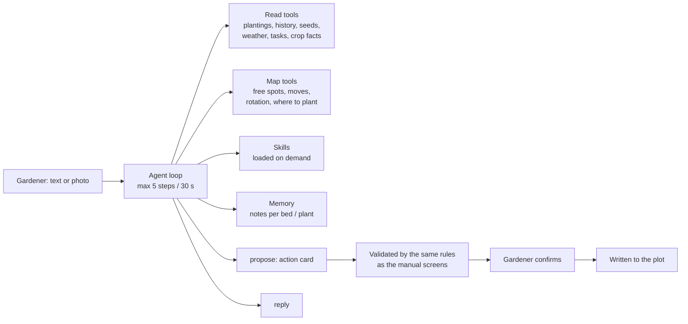

# Plotia — a garden plot as a living farm in your phone

**Product case study: web/PWA app with an AI garden agent** 
Website: [plotia.space](https://plotia.space) · Live app: [app.plotia.space](https://app.plotia.space)

*Status: working prototype, live in production, pre-launch. Billing runs in the payment provider's sandbox.*

## Origin

I took a product brief from the gardening domain: choose an idea with the strongest monetization potential and bring it to a working prototype. The product had to be used **often** (a gardener opens it out of habit), be **sticky** (the more you use it, the more it gives back) and make **leaving more costly** over time.

I started with research instead of features: about 2,000 gardening questions from Reddit (UK, US, AU) and 4,300 app-store reviews of competing garden apps were classified, and the findings fed the product decisions. The clearest signals were a dislike of hard paywalls and the fact that gardeners need advice that fits *their* plot, not generic tips.

## The product

Plotia turns a real garden or allotment into a 2.5D isometric map. Plants grow on it by their planting dates, so the map becomes a living record of the plot.

- **Plot map** in real metres or feet: beds, greenhouse, trees, flower borders, equipment, decor.
- **Plant cards with a photo diary**, weekly tasks driven by the forecast and the plant stage.
- **Plant Doctor:** photo → diagnosis in the context of this plot → treatments from the regional product list → a treatment log with a waiting-period timer.
- **Plotia, the garden agent** (below): a chat that knows the whole plot and can act on it.
- **Game layer:** "seeds" are earned only for real actions and as cashback on partner purchases; streaks, levels, decor.
- **Social:** share cards, guests who comment on beds and plants, before/after experiments on a bed, plot templates from creators.
- **Winter mode:** a dream-plot planner and a seedling plan on the same map.
- **Commerce:** phantom objects on the map (the gardener sees the tool or bed in place before buying) with affiliate checkout.

Onboarding is a short quiz ("what do you have?"); the map assembles itself, location comes from a postcode or region (UK region / USDA zone).

## Plotia, the garden agent

The chat is not a generic assistant behind a text box. It works from a compact model of the plot and is allowed to write to it only through rules the gardener approves.

Key engineering decisions:

- **Rules give facts, the model chooses and explains.** Stage of a plant, waiting periods, frost dates, spacing and rotation come from deterministic code. The model never calculates them; it selects and explains.
- **Nothing is written without confirmation.** "I sprayed the tomatoes yesterday" becomes a proposed card. The server validates ids, dates, weights and crops, rejects the unknown, asks the gardener to choose when the target is ambiguous, and writes only after "Confirm", using the same functions as the manual UI.
- **Placement by purpose.** Asking to "put the shredder somewhere" is solved on the map: free spots are computed, an electric tool gets a cable run or a spot by the socket, and the warning is on the card.
- **Memory in layers.** Durable notes tied to a bed or plant, plus a background "Chronicler" model that adds, rewrites and deletes only notes it was shown, never the gardener's own, and compacts long threads. The gardener sees and can delete anything the agent remembers.
- **Model roles instead of one model.** `main`, `vision`, `fast`, `background`, `offline`, each with its own provider fallback chain. Models were chosen by a measured probe, not by taste; photos are looked at once by a vision model and the description is reused.
- **Skills on demand** (Agent Skills format): the prompt holds only a list; the text of a skill is loaded when needed, and only approved skills for the user's market are offered.
- **Evaluation set.** A reference set of plot scenarios with an automated runner scores five configurations. The chosen configuration (GLM main model with Gemini as the eyes) passed 23 of 23 checks; a single-call answer passed 18. Three checks that were wrong were fixed and saved runs were re-scored without calling any model.
- **Observable by design.** Every turn is stored with model, tokens, latency, tools and errors; the chat shows what Plotia is doing while the gardener waits, for example "Looking at the photos: Tomato".

## Business model

Freemium with a viral loop: one plot and two people free, so sharing a plot with a partner costs nothing. Pro is a subscription or lifetime pass; revenue also comes from in-app physical e-commerce (phantom objects on the map) and creator templates. Seeds can be spent on a month of Pro and an extra diagnosis but cannot be bought with money. Unit economics were calculated in three scenarios, and the numbers showed that paid acquisition does not pay back, so growth is designed to be viral and free.

Payments go through a Merchant of Record (Paddle) so that VAT in the UK, EU and elsewhere is not the product's burden. The integration, with webhooks and regional prices, is built and tested in the sandbox.

## Market

Two brands from one codebase: **Plotia** for the UK/US (beachhead: the UK, where the allotment culture matches the plot-owner use case) and **Ogorodia** for Russia/CIS. English by default with a Russian switch; regional agronomy (No-Dig, raised beds and organic methods in the UK/US) lives in data and prompts, not in the code.

## My role

I defined the product and the research method, designed the architecture, and built the product with AI coding agents (Claude Code and Codex): frontend, backend, the garden agent and its evaluation, billing, deployment, the landing and the pitch deck. I review what agents write, decide scope, and keep an audit trail in the repository.

## Technology

| Layer | Technologies |
|---|---|
| App | React 19, TypeScript, Vite, PWA, Tailwind CSS 4, shadcn/ui, TanStack Query, Zustand |
| Plot map | PixiJS 8 (2D WebGL, 2.5D isometric), gestures, scene export for share cards |
| Backend | Python 3.12, FastAPI, Pydantic 2, SQLAlchemy 2 (async), Alembic, APScheduler |
| Data | PostgreSQL 17 with pgvector, JSONB for map objects, a transactional seed ledger |
| AI | Provider-agnostic OpenAI-format client with structured JSON outputs, tool-calling agent loop, vision roles, memory, skills, eval runner |
| Weather | Open-Meteo |
| Payments | Paddle Billing (sandbox), Stripe kept as a fallback |
| Landing | Astro, Tailwind |
| Infrastructure | Docker Compose, nginx, Let's Encrypt on a VPS |

## Public case-study boundary

The source code is private. API keys, payment credentials and server details are not published. The live product and the marketing site are public and can be used as they are.
