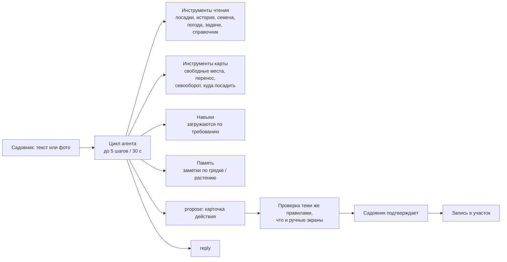

# Plotia — реальный участок как живая ферма в телефоне

**Кейс продукта: веб/PWA-приложение с ИИ-агентом для огородника** 
Сайт: [plotia.space](https://plotia.space) · Живое приложение: [app.plotia.space](https://app.plotia.space)

*Статус: рабочий прототип, выложен в продакшн, до запуска. Оплата работает в песочнице платёжного провайдера.*

## Откуда взялось

Я взял задачу из сферы огородничества: выбрать идею с максимальным потенциалом монетизации и довести её до работающего прототипа. Продуктом должны пользоваться **часто** (открывают по привычке), он должен **затягивать** (чем больше пользуешься, тем больше даёт) и делать **уход всё дороже**.

Начал с исследования, а не с функций: разметил около 2 000 вопросов огородников на Reddit (Великобритания, США, Австралия) и 4 300 отзывов о конкурирующих приложениях из магазинов. Главные выводы: людям не нравятся жёсткие пейволлы, и нужны советы под *их* участок, а не общие.

## Продукт

Plotia превращает реальный участок в изометрическую карту 2.5D. Растения растут по датам посадки, так что карта становится живой историей участка.

- **Карта участка** в метрах или футах: грядки, теплица, деревья, клумбы, оборудование, декор.
- **Карточки растений с фото-дневником**, задачи недели с учётом прогноза и стадии растений.
- **Доктор растений:** фото → диагноз с контекстом участка → препараты из регионального справочника → журнал обработок с таймером срока ожидания.
- **Plotia, агент участка** (ниже): чат, который знает весь участок и может в нём действовать.
- **Игровой слой:** «семечки» только за реальные действия и как кэшбэк за партнёрские покупки, серии недель, уровни, декор.
- **Социальное:** карточки для шеринга, гости, которые комментируют грядки и растения, эксперименты «до / после», шаблоны участков от блогеров.
- **Зима:** планировщик участка мечты и план рассады на той же карте.
- **Покупки:** фантомные объекты на карте (садовник видит инструмент или грядку на своём месте до покупки) и партнёрская оплата.

Вход в продукт — короткий квиз «что у вас есть»; карта собирается сама, местоположение берётся по почтовому коду или региону (регион Великобритании / зона USDA).

## Plotia — агент участка

Чат — не абстрактный ассистент за текстовым полем. Он работает с компактной моделью участка и может писать в неё только через правила, которые садовник подтверждает.

Ключевые инженерные решения:

- **Правила дают факты, ИИ выбирает и объясняет.** Стадия растения, сроки ожидания, даты заморозков, расстояния и севооборот считает обычный код. Модель ничего не вычисляет, она отбирает и объясняет.
- **Без подтверждения ничего не пишется.** «Вчера опрыскал помидоры» превращается в карточку-предложение. Сервер проверяет id, даты, вес и культуру, отбрасывает неизвестное, спрашивает садовника, если цель неясна, и записывает только после «Подтвердить» теми же функциями, что и ручной экран.
- **Размещение по назначению.** Просьба «поставь куда-нибудь измельчитель» решается на карте: считаются свободные места, электроинструменту предлагается проложить кабель или встать у розетки, а предупреждение стоит на карточке.
- **Память в слоях.** Долгие заметки с привязкой к грядке или растению и фоновая модель «Летописец», которая добавляет, переписывает и удаляет только показанные ей заметки (заметки садовника не трогает) и сворачивает длинные беседы. Садовник видит всё, что помнит агент, и может удалить любую заметку.
- **Роли моделей вместо одной модели.** `main`, `vision`, `fast`, `background`, `offline`; у каждой своя цепочка запасных провайдеров. Модели выбраны по замеру, а не по вкусу; фото смотрится один раз моделью зрения, описание переиспользуется.
- **Навыки по требованию** (формат Agent Skills): в промпте только список, текст навыка загружается при необходимости, и предлагаются только утверждённые навыки рынка пользователя.
- **Эталонный набор.** Автоматический прогон по сценариям участка оценил пять конфигураций. Выбранная (главная модель GLM с Gemini в роли «глаз») прошла 23 проверки из 23, ответ одним вызовом — 18. Три неверных проверки исправлены, а сохранённые прогоны пересчитаны без вызова моделей.
- **Наблюдаемость.** Каждый ход хранится с моделью, токенами, временем, инструментами и ошибками; пока садовник ждёт, чат показывает, что делает Plotia, например «Смотрю фото: Томат».

## Бизнес-модель

Freemium с виральной петлёй: один участок и два человека бесплатно, поэтому вести участок вдвоём ничего не стоит. Pro — подписка или пожизненный доступ; ещё выручка от физической торговли внутри приложения (фантомные объекты на карте) и шаблонов авторов. «Семечки» можно потратить на месяц Pro и ещё один диагноз, но за деньги их купить нельзя. Юнит-экономика посчитана в трёх сценариях, и цифры показали, что платное привлечение не окупается, поэтому рост задуман вирусным и бесплатным.

Оплата идёт через Merchant of Record (Paddle), чтобы налог на добавленную стоимость в Великобритании, ЕС и других странах не был заботой продукта. Интеграция с вебхуками и региональными ценами готова и проверена в песочнице.

## Рынок

Два бренда на одном коде: **Plotia** для Великобритании и США (плацдарм — Великобритания: культура allotments совпадает со сценарием владельца участка) и **Огородия** для России и СНГ. Английский язык по умолчанию с переключателем на русский; региональная агрономия (No-Dig, приподнятые грядки и органика для Великобритании и США) живёт в данных и промптах, а не в коде.

## Моя роль

Определил продукт и метод исследования, спроектировал архитектуру и построил продукт вместе с ИИ-агентами для кода (Claude Code и Codex): интерфейс, бэкенд, агент участка и его оценку, оплату, развёртывание, лендинг и презентацию. Проверяю то, что пишут агенты, решаю про объём и веду в репозитории журнал решений.

## Технологии

| Слой | Технологии |
|---|---|
| Приложение | React 19, TypeScript, Vite, PWA, Tailwind CSS 4, shadcn/ui, TanStack Query, Zustand |
| Карта участка | PixiJS 8 (2D WebGL, изометрия 2.5D), жесты, выгрузка сцены для карточек |
| Бэкенд | Python 3.12, FastAPI, Pydantic 2, SQLAlchemy 2 (async), Alembic, APScheduler |
| Данные | PostgreSQL 17 с pgvector, JSONB для объектов карты, журнал «семечек» с транзакциями |
| ИИ | Клиент в формате OpenAI с любым поставщиком, структурированные JSON-ответы, цикл агента с инструментами, роли зрения, память, навыки, прогон эталона |
| Погода | Open-Meteo |
| Оплата | Paddle Billing (песочница), Stripe как запасной вариант |
| Лендинг | Astro, Tailwind |
| Инфраструктура | Docker Compose, nginx, Let's Encrypt на VPS |

## Граница публичного кейса

Исходный код закрыт. Ключи API, платёжные данные и сведения о сервере не публикуются. Живой продукт и сайт открыты и доступны как есть.
